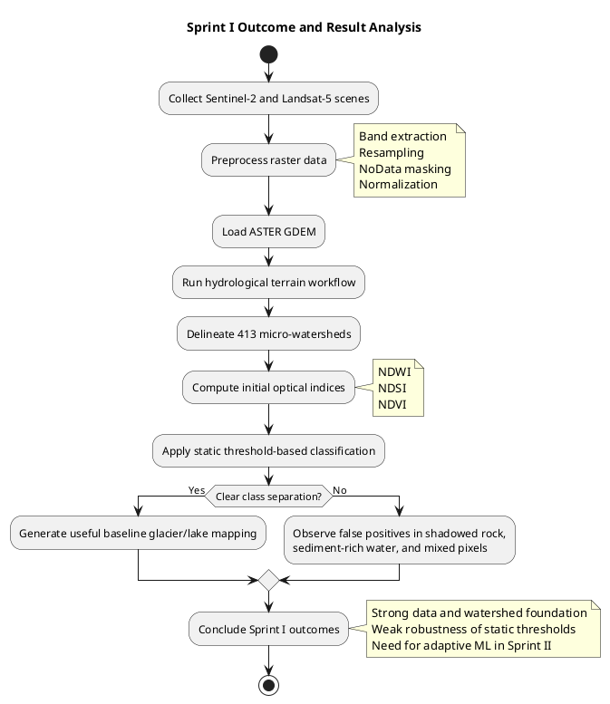

# 3.1.4 Outcome of Objectives / Result Analysis (Sprint I)

Sprint I successfully established the technical foundation of the project by organizing the multi-temporal satellite archive, standardizing spatial resolution, and initiating DEM-based hydrological interpretation for the study area. Based on the existing project documents and pipeline modules, the first sprint achieved two major outcomes. First, the preprocessing workflow aligned multi-source optical data from Sentinel-2 and Landsat-5 into a common analytical framework, enabling consistent temporal comparison across the study period. Second, the DEM-driven watershed workflow successfully delineated 413 micro-watersheds, which is a critical result because it provides the hydrological linkage between high-altitude glacial lakes and the downstream valleys exposed to flood risk.

The Sprint I outputs proved that the project could move beyond manual GIS operations and execute foundational terrain analysis in an automated way. The codebase shows the intended preprocessing and DEM-analysis structure through modules such as `data_processing.py`, `dem_analysis.py`, and `indices_calculation.py`, while the project documents confirm that the event-driven pipeline handled data ingestion, resampling, index generation, and watershed extraction as the base architecture for later sprints. In that sense, Sprint I was successful as an infrastructure-building sprint: it created the data backbone, the terrain context, and the initial optical classification logic required for future hazard evaluation.

However, the result analysis also revealed a major limitation in the Sprint I approach. The threshold-based optical classification logic was not sufficiently robust for complex glacial terrain. Static rules such as NDWI-driven lake detection performed well in clear cases, but they struggled in mountain shadows, sediment-rich lake margins, and mixed snow-water pixels. As noted in the mega document, the overlap between turbid water signatures and saturated barren terrain caused false positives, while shadowed rock surfaces were sometimes misidentified as water. Therefore, even though Sprint I succeeded in data preparation and hydrological structuring, it also demonstrated that rigid Boolean thresholding alone was inadequate for high-confidence GLOF mapping.

From a project management perspective, Sprint I should be considered a successful exploratory and foundational sprint rather than a final analytical sprint. Its main result was not the production of a perfect classification map, but the validation of the project workflow itself: multi-year imagery could be ingested, processed, and connected to watershed geometry automatically, and the weaknesses of the first-generation classification logic were clearly exposed. This outcome directly justified the transition to Sprint II, where adaptive machine learning methods were introduced to reduce misclassification and convert the baseline geospatial workflow into a more reliable intelligence system.

## Result Summary Table

| Sprint I Objective | Expected Outcome | Actual Result Achieved | Evidence from Project Assets | Status |
|---|---|---|---|---|
| Build multi-temporal remote sensing dataset | A usable archive of Sentinel-2 and Landsat-5 scenes for glacier-lake monitoring | A 66-scene Sentinel-2 archive for 2021-2025 was compiled, with Landsat-5 used for historical baseline support | `Review_2_Mega_Document.md`, `Final_Project_Report.md` | Achieved |
| Standardize input data for analysis | Spatially aligned and normalized raster inputs across sensors | The workflow defined band extraction, resampling, NoData masking, and normalization for optical imagery | `Review_2_Mega_Document.md`, `data_processing.py` | Achieved |
| Generate terrain and hydrological context | Catchment boundaries linking glacial lakes to downstream valleys | 413 micro-watersheds were delineated using DEM-based hydrological logic | `Final_Project_Report.md`, `Review_2_Mega_Document_Extended.txt` | Achieved |
| Perform initial lake and glacier identification | Threshold-based optical separation of glacier, lake, and terrain classes | Initial classification was operational, but false positives occurred in shadows and sediment-rich terrain | `Review_2_Mega_Document.md`, `Review_2_Mega_Document_Extended.txt`, `indices_calculation.py` | Partially Achieved |
| Establish baseline for later risk modeling | A strong enough analytical base for Sprint II expansion | Sprint I successfully exposed the need for adaptive classification and enabled Sprint II architecture decisions | `Final_Project_Report.md`, `Architecture_Document.md` | Achieved |

## PlantUML Diagram for Sprint I Results



## Compact Table for Direct Report Insertion

| Parameter | Sprint I Result |
|---|---|
| Temporal dataset prepared | 66 Sentinel-2 scenes from 2021-2025, supported by Landsat-5 historical context |
| Core terrain output | 413 micro-watersheds delineated |
| Main technical success | Automated preprocessing and hydrological mapping |
| Main analytical limitation | Static thresholding caused misclassification in complex glacial terrain |
| Decision taken for next sprint | Move to adaptive machine learning classification |

## ChatGPT Prompt for Expanding This Section

```text
Write a formal academic project report section titled "3.1.4 Outcome of Objectives / Result Analysis (Sprint I)" for a GLOF monitoring project. Use a clear, engineering-report style suitable for a minor project or academic review report.

Project context:
- The project is about automated Glacial Lake Outburst Flood (GLOF) monitoring using remote sensing and terrain analysis.
- Sprint I focused on building the project foundation, not the final intelligence layer.
- The dataset included 66 Sentinel-2 scenes from 2021-2025 and Landsat-5 imagery for historical support.
- Preprocessing included band extraction, spatial alignment/resampling, NoData handling, and normalization.
- DEM-based hydrological analysis delineated 413 micro-watersheds to connect glacial lakes with downstream valleys.
- Initial optical analysis used NDWI, NDSI, and NDVI with threshold-based classification.
- Sprint I succeeded in automation and watershed extraction, but static thresholding produced false positives in mountain shadows, sediment-rich lake margins, and mixed snow-water terrain.
- The outcome of Sprint I justified the move to adaptive machine learning in Sprint II.

What to produce:
- 4 to 6 strong paragraphs.
- Mention both achievements and limitations.
- Emphasize that Sprint I was successful as a foundational sprint.
- Maintain formal academic tone.
- Do not invent numerical accuracy metrics.
- End with a concluding line that explains why Sprint II became necessary.
```

## Source Basis Used

- `Final_Project_Report.md`
- `Review_2_Mega_Document.md`
- `Review_2_Mega_Document_Extended.txt`
- `Architecture_Document.md`
- `data_processing.py`
- `dem_analysis.py`
- `indices_calculation.py`
